<div align="center">


<p>


</p>
<p>


</p>

<b>A research prototype that learns when to switch traffic lights</b>, using a SUMO digital twin, a structured traffic-context model (CAMP), continuous reinforcement learning, live phone cameras and an independent safety filter.

<a href="#-quick-start">Quick start</a> ·
<a href="#-how-it-works">How it works</a> ·
<a href="#-dashboard-tour">Dashboard</a> ·
<a href="#-results-honest-numbers">Results</a> ·
<a href="#-live-cameras--advisory">Cameras &amp; advisory</a> ·
<a href="#-the-method-camp-crl">Method</a> ·
<a href="#%EF%B8%8F-limitations">Limitations</a>

</div>

> [!WARNING]
> **Simulation and advisory only.** SignalSense AI never connects to, or controls, a real traffic signal. Camera data only creates vehicles inside the SUMO simulation or feeds a *recommendation* screen. Nothing here is validated for use at a real junction.

---

## ✨ At a glance

**SignalSense AI** is the application. **CAMP-CRL** (*Context-Aware Multi-Strategy Continuous Reinforcement Learning*) is the research method inside it.

<table>
<tr>
<td width="33%" valign="top">

### 🚦 Simulate
A four-arm SUMO junction with **11 traffic scenarios** (surges, bottlenecks, noisy sensors), split into train / validation / **held-out test**. Five baseline controllers are compared over 10 seeds with bootstrap confidence intervals.

</td>
<td width="33%" valign="top">

### 🧠 Learn
**CAMP** turns raw counts into pressure, momentum, risk and fairness, then picks a strategy. **TD3 / DDPG / SAC** agents learn continuous switch decisions, blended with the CAMP rule by an adaptive gate.

</td>
<td width="33%" valign="top">

### 📷 See
Phone cameras (IP Webcam), webcams or video files run through **YOLOX + tracking**. Counts, queues and arrivals feed SUMO, or a **live timing advisory** with a default 30 s loop when the roads are clear.

</td>
</tr>
</table>

| | Built | Notes |
|---|:---:|---|
| Phase 1: simulation, baselines, CAMP, safety filter, dashboard | ✅ | 550-run evaluation (5 controllers × 11 scenarios × 10 seeds) |
| Phase 2: Gymnasium env, reward, TD3/DDPG/SAC, CAMP prior, fusion gate | ✅ | 12 agents trained (4 configs × 3 seeds); **held-out test evaluation running**, see [results](#phase-2-reinforcement-learning) |
| Phase 3: cameras, detection, tracking, health, fallback, camera → SUMO | ✅ | Tested with a real phone stream; real-traffic counting not yet validated |
| Live camera feed on the dashboard (raw or with detections) | ✅ | ~21 fps video, detection ~10 Hz on CPU |
| Live signal-timing advisory | ✅ | Recommends only; never drives a signal |

---

## 🔄 How it works

<div align="center">
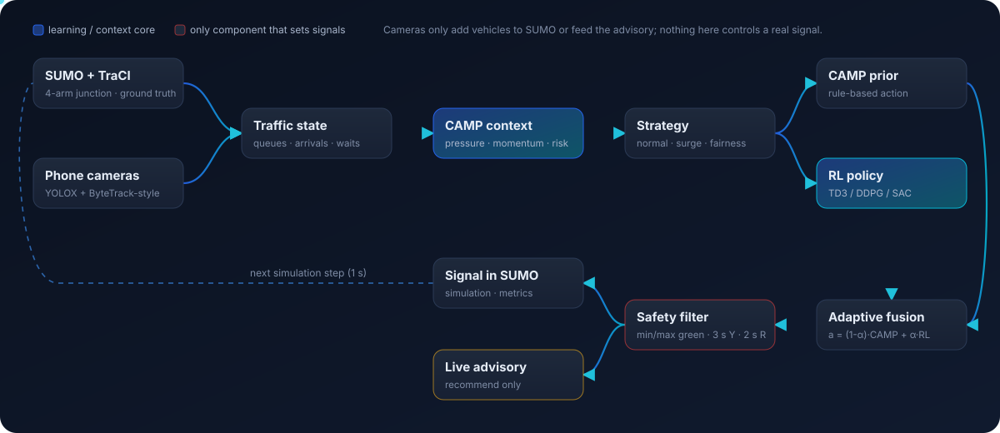
</div>

Every simulated second the same loop runs:

1. **Observe:** SUMO (through TraCI) or cameras give per-approach queues, arrivals, waits and downstream congestion. A sensor model can add noise and dropouts.
2. **Understand:** the CAMP engine computes pressure, momentum, heuristic risk and fairness, plus a trend, traffic pattern, surge alarm and data-confidence score.
3. **Decide:** a strategy is chosen (normal, surge response, fairness recovery, overflow prevention …). The CAMP rule and the RL policy each propose an action, and the fusion gate blends them.
4. **Stay safe:** the **safety filter** is the only component that can change a signal. It enforces min/max green, the 3 s yellow and 2 s all-red, and the starvation bound, and logs every override.
5. **Measure:** delay, queue, throughput, fairness, spillback and interventions are recorded for every run.

<details>
<summary><b>📐 Detailed architecture (Mermaid)</b></summary>

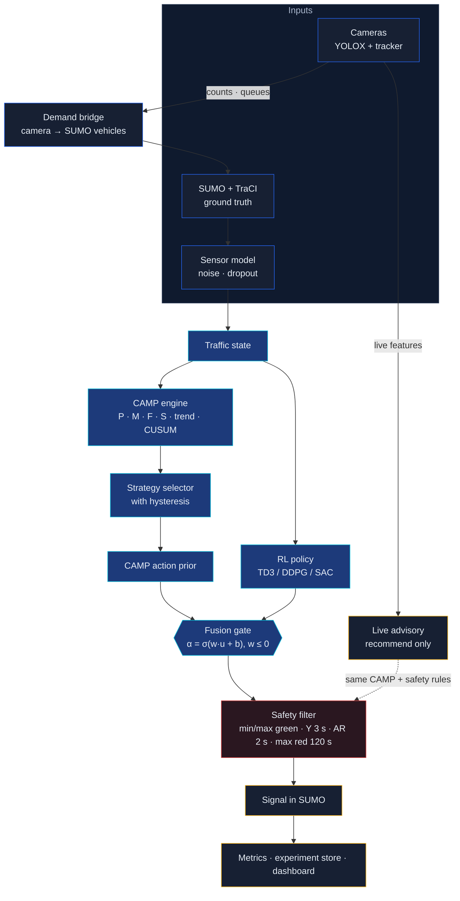

</details>

---

## 🚀 Quick start

> **Windows + PowerShell.** Python 3.14 (3.11+ should work) and Node.js 20+ (only to build the dashboard). `eclipse-sumo` installs SUMO inside the virtual environment, so there's no system SUMO or `SUMO_HOME` to set up.

```powershell
cd C:\Users\rahul\Desktop\pp2
.\start.ps1            # installs deps if needed, builds the dashboard, opens http://127.0.0.1:8000
.\start.ps1 -Test      # run all Python + frontend tests first
.\start.ps1 -Gui       # watch one episode in the SUMO GUI window instead
```

<details>
<summary><b>🧩 Optional extras: RL training and camera perception</b></summary>

```powershell
.\.venv\Scripts\python -m pip install -r requirements-rl.txt       # torch (CPU), gymnasium, stable-baselines3
.\.venv\Scripts\python -m pip install -r requirements-vision.txt   # opencv-python-headless, onnxruntime
curl -L -o models/yolox_nano.onnx https://github.com/Megvii-BaseDetection/YOLOX/releases/download/0.1.1rc0/yolox_nano.onnx
```

Run the backend on another port (for example if 8000 is taken):

```powershell
.\.venv\Scripts\python -m uvicorn camp_crl.api.app:app --host 127.0.0.1 --port 8010
```

Develop the dashboard with hot reload:

```powershell
.\.venv\Scripts\python -m uvicorn camp_crl.api.app:app --port 8000   # terminal 1
cd frontend; npm run dev                                              # terminal 2 → http://localhost:5173
```

</details>

<details>
<summary><b>⌨️ Command line</b></summary>

```powershell
.\.venv\Scripts\Activate.ps1
python -m camp_crl.cli run --controller camp_rule --scenario surge_n --seed 1 [--gui]
python -m camp_crl.cli tune-fixed --grid 10 12 15 20 25 30                # train scenarios only
python -m camp_crl.cli compare --scenario ns_dominant --seeds 1 2 3
python -m camp_crl.cli evaluate --splits train validation                 # 10 seeds, parallel
python -m camp_crl.cli evaluate --splits train validation test --allow-test   # final report only

python -m camp_crl.rl.train --algo td3 --obs camp --seed 1 --timesteps 60000 --n-envs 2
python -m camp_crl.rl.batch --configs ddpg/raw td3/raw td3/camp sac/camp --seeds 1 2 3 --timesteps 60000
python -m camp_crl.rl.evaluate --runs runs/rl/<id> ... --baseline-experiment <evaluation id>
python -m camp_crl.rl.reward_sensitivity --seeds 1 2

python -m camp_crl.vision.demo --controller actuated --seed 1      # 4 synthetic cameras, scripted faults
python -m camp_crl.vision.demo --check-yolo                         # YOLOX on the fixture photos
python -m camp_crl.vision.probe --source http://192.168.0.110:8080/video --seconds 30
```

Held-out (`split: test`) scenarios are always refused by `tune-fixed`, and by `compare` / `evaluate` / the API unless explicitly allowed.

</details>

---

## 🖥️ Dashboard tour

Ten pages in three groups: **Monitor** (Overview, Live Intersection, Live Advisory, Cameras), **Analyze** (CAMP Explainability, Experiment Lab, Evaluation) and **System** (Configuration, System Health, Methodology).

<table>
<tr>
<td width="50%">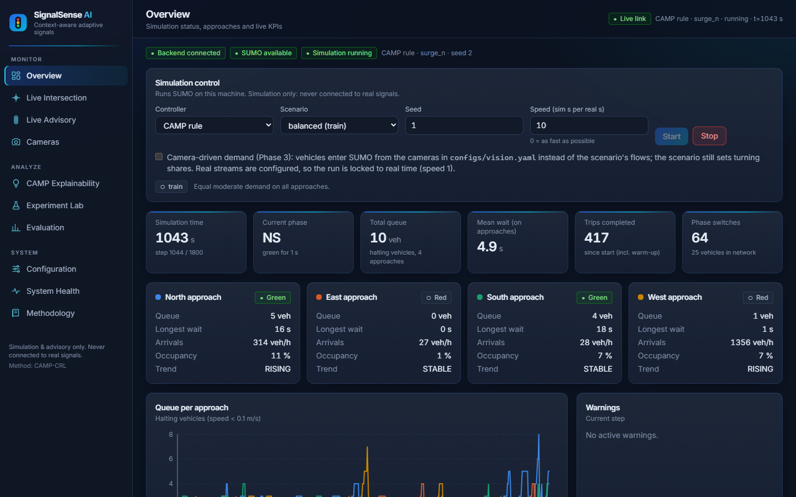<br/><sub><b>Overview</b>: start a run, live KPIs, one card per approach</sub></td>
<td width="50%">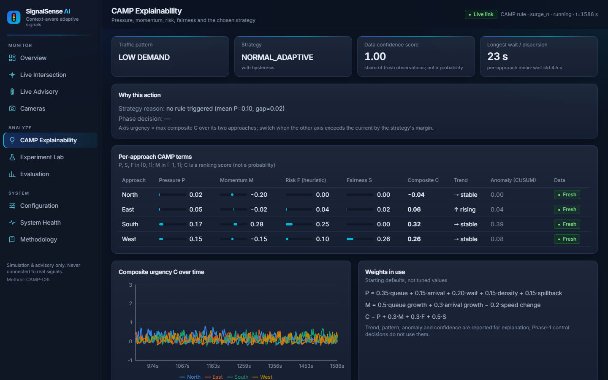<br/><sub><b>CAMP Explainability</b>: why the controller acted, term by term</sub></td>
</tr>
<tr>
<td width="50%">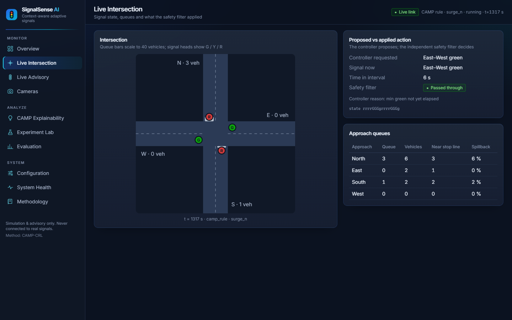<br/><sub><b>Live Intersection</b>: what was requested vs what the safety filter applied</sub></td>
<td width="50%">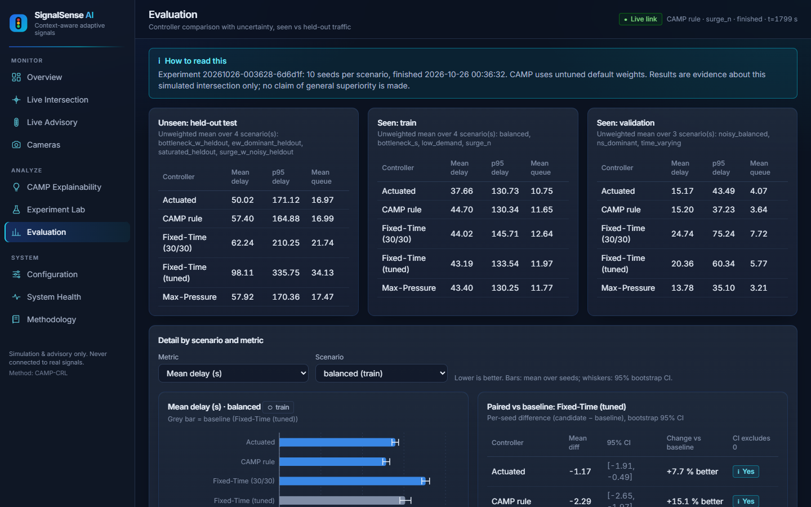<br/><sub><b>Evaluation</b>: seen vs held-out traffic, paired differences with 95% CIs</sub></td>
</tr>
<tr>
<td colspan="2" align="center">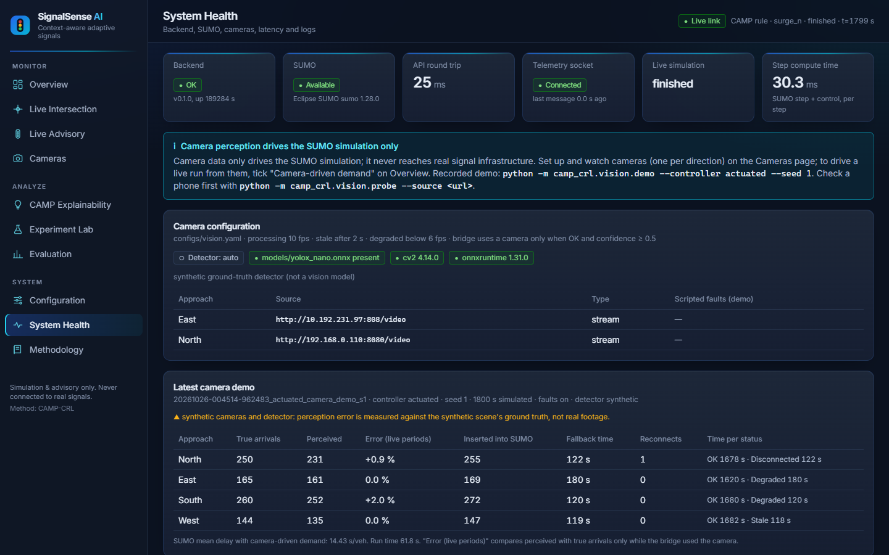<br/><sub><b>System Health</b>: backend, SUMO, camera status timeline, annotated frames and logs</sub></td>
</tr>
</table>

<details>
<summary><b>📄 What each page does</b></summary>

| Page | What you can do |
|---|---|
| **Overview** | Pick controller / scenario / seed / speed and start or stop SUMO; tick *Camera-driven demand*; live KPIs, approach cards, queue chart, warnings |
| **Live Intersection** | Top-down schematic, signal heads, queues, proposed vs applied action, live camera cards during camera runs |
| **Live Advisory** | Recommended phase and countdown from your cameras, the coming sequence, per-direction readings, live videos |
| **Cameras** | Paste a camera URL per direction, test it, watch the live feed raw or with detections |
| **CAMP Explainability** | Pressure, momentum, risk, fairness, composite urgency, trend, CUSUM anomaly, strategy and reason |
| **Experiment Lab** | Multi-seed experiments with progress, logs and CSV/JSON export; RL training curves |
| **Evaluation** | Controller comparison per split, uncertainty, paired tests vs a baseline, RL results card |
| **Configuration** | Validated timing limits, CAMP weights, scenarios and RL settings (read-only) |
| **System Health** | Backend / SUMO / camera status, latency, camera demo timeline, annotated frames, logs |
| **Methodology** | Architecture, equations, glossary, implementation status, limitations |

Every control either works or is disabled with a reason. Loading, empty, error, disconnected and stale-data states are all handled.

</details>

---

## 📷 Live cameras & advisory

### Connect phones from the dashboard

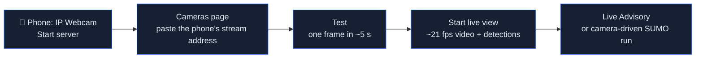

- **One camera per direction** (North, East, South, West). Sources can be `http(s)://` or `rtsp://` streams, a webcam number, `synthetic` (demo) or `none`.
- Settings are saved to `configs/cameras.local.json`, which is git-ignored because stream URLs may contain passwords. The API only ever returns them **redacted**.
- **Live view** passes the camera's frames straight through at its own frame rate (MJPEG). YOLOX runs on the same frames about 10 times a second. A toggle shows the raw picture without boxes.

<details>
<summary><b>🩺 Camera health and safe fallback</b></summary>

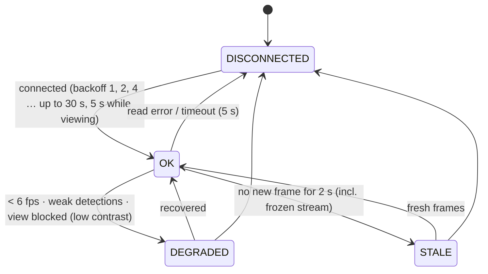

Only an **OK** camera with confidence ≥ 0.5 is trusted. Otherwise its approach falls back to Poisson arrivals at the last trusted rate, or a default of 400 veh/h, and counts made during the fault are **discarded, not replayed**.

</details>

### Live signal-timing advisory

<div align="center">
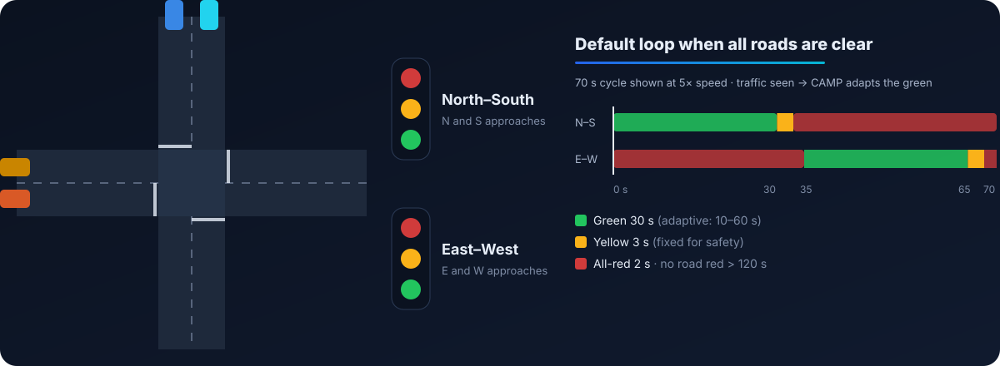
</div>

| Situation | Advice |
|---|---|
| All four directions have working cameras and have been **clear for 5 s** | **Default loop: 30 s green each way** (+ 3 s yellow + 2 s all-red) |
| Traffic seen and both roads (N–S and E–W) have a working camera | **Adaptive**: CAMP decides when to switch from live counts, queues, arrivals and measured waits |
| A whole road has no working camera | **Default loop**, with the reason stated (*"no working camera on the East–West road, so its traffic is unknown"*) |
| Under constant demand | Green is still capped at 60 s; no road stays red longer than 120 s |

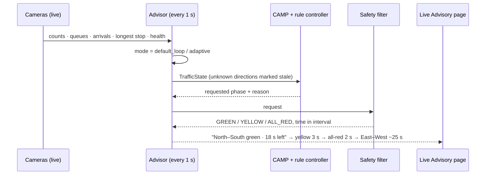

> [!NOTE]
> When CAMP holds a green because cars keep arriving, the page shows **"hold · at most N s more"** instead of an invented countdown. Green estimates assume about one vehicle leaves per second per approach after a 2 s start.

---

## 📊 Results (honest numbers)

All numbers below were measured in this repository. Lower delay is better. No result is claimed to generalise beyond this simulated junction.

### Phase 1: baselines vs CAMP

Mean delay per vehicle (s); unweighted mean over the scenarios in each split, 10 seeds each (experiment `20261026-003628-6d6d1f`).

| Controller | Train (seen) | Validation | **Held-out test** |
|---|---:|---:|---:|
| **Actuated** (gap-out) | **37.66** | 15.17 | **50.02** |
| Max-Pressure | 43.40 | **13.78** | 57.92 |
| CAMP rule (untuned defaults) | 44.70 | 15.20 | 57.40 |
| Fixed-Time 30/30 | 44.02 | 24.74 | 62.24 |
| Fixed-Time tuned (20/12, on train) | 43.19 | 20.36 | 98.11 |

> **Reading it honestly:** the CAMP rule is competitive with Max-Pressure but does **not** beat the Actuated baseline, especially on held-out traffic. The tuned Fixed-Time plan generalises poorly to the unseen east-west-dominant scenario (106 s there).

<details>
<summary><b>Per-scenario means and the Fixed-Time tuning disclosure</b></summary>

| Scenario | Split | Actuated | CAMP rule | Fixed 30/30 | Fixed tuned | Max-Pressure |
|---|---|---:|---:|---:|---:|---:|
| balanced | train | 13.97 | 12.85 | 17.61 | 15.15 | 12.42 |
| bottleneck_s | train | 114.80 | 142.67 | 125.31 | 131.84 | 140.30 |
| low_demand | train | 8.61 | 9.97 | 14.76 | 11.70 | 8.68 |
| surge_n | train | 13.25 | 13.29 | 18.41 | 14.05 | 12.21 |
| noisy_balanced | validation | 16.76 | 13.86 | 18.55 | 16.86 | 13.44 |
| ns_dominant | validation | 14.91 | 16.64 | 31.93 | 16.28 | 14.48 |
| time_varying | validation | 13.85 | 15.09 | 23.72 | 27.94 | 13.42 |
| bottleneck_w_heldout | test | 135.44 | 163.46 | 157.00 | 192.50 | 170.94 |
| ew_dominant_heldout | test | 15.42 | 17.39 | 37.66 | 106.18 | 15.35 |
| saturated_heldout | test | 34.82 | 33.33 | 35.04 | 62.36 | 32.21 |
| surge_w_noisy_heldout | test | 14.42 | 15.40 | 19.24 | 31.40 | 13.20 |

**Disclosure:** the Fixed-Time tuning objective was changed from raw mean delay to *relative regret* (mean of plan delay ÷ best plan delay per scenario) **after** held-out results had been seen, because the raw mean was dominated by the bottleneck scenario. The flaw is visible on training data alone, and the change could only make the baseline stronger. The new objective picked **the same 20/12 plan**, so the numbers are unchanged. Every run's 95% bootstrap CI and paired differences are on the Evaluation page.

</details>

### Phase 2: reinforcement learning

**Reward check before training.** Five fixed policies were rolled out on the training scenarios to see whether the reward ranks policies the way mean delay does:

| Queue weight | Spearman (reward vs −delay) | Best-by-reward = best-by-delay |
|---:|---:|---:|
| 1.0 (first draft) | 0.67 | 88 % |
| **2.0 (used)** | **0.84** | **100 %** |

**Training** (60 000 steps each, 3 training seeds; train scenarios only; best checkpoint chosen on validation seeds 1001–1002). Best validation mean delay (s):

| Agent | Seed 1 | Seed 2 | Seed 3 | Mean ± SD |
|---|---:|---:|---:|---:|
| **TD3, raw state** | 12.88 | 12.58 | 13.12 | **12.86 ± 0.27** |
| DDPG, raw state | 13.14 | 13.52 | 13.05 | 13.23 ± 0.25 |
| SAC, CAMP state | 13.95 | 13.81 | 13.54 | 13.77 ± 0.21 |
| TD3, CAMP state | 14.06 | 32.39 ⚠️ | 14.11 | 20.19 ± 10.57 |

> [!IMPORTANT]
> These are **validation** numbers on 2 seeds, not the final test. For scale only: the baselines' validation means (10 seeds) are 13.78 s (Max-Pressure) and 15.17 s (Actuated). ⚠️ TD3-CAMP seed 2 **collapsed**: it stayed at exactly 32.39 s at every checkpoint, which points to a degenerate fixed policy. It is reported, not dropped. **The held-out test evaluation of all 12 agents (2 090 rollouts, including the camp / rl / fixed / gated fusion ablation) is running**; its results will replace this note.

### Phase 3: perception

| Check | Result |
|---|---|
| Counting vs synthetic ground truth, 10 fps | **0 % error** at 0–15 % detector misses |
| Same at 3–5 fps | over-counts by up to 14 % → cameras below 6 fps are marked *degraded* |
| 1 800 s demo, one fault per camera | all four faults detected and recovered; counting error while trusted **0 to +2 %** |
| YOLOX nano on real 1080p frames (6 frames, 47 vehicles, labelled by eye) | clear vehicles ≥ 5 % of frame width: **18 / 18**; smaller: 5 / 13; partly hidden: 1 / 16; **0 false positives** |
| Real phone over Wi-Fi | 21 fps live video, detection ~10 Hz at ~13 ms/frame, real dropout → automatic reconnect |

<details>
<summary><b>Camera demo detail (seed 1, 1 800 s, synthetic cameras)</b></summary>

| Camera | Fault | Detected as | Recovered | Error while trusted |
|---|---|---|---|---:|
| North | disconnect 600–720 s | disconnected → fallback | reconnected at 722 s (backoff) | +0.9 % |
| East | low frame rate 900–1080 s | degraded (5.9 fps) | 1081 s | 0.0 % |
| South | full occlusion 1200–1320 s | degraded (contrast 0) | 1320 s | +2.0 % |
| West | frozen stream 1440–1560 s | low confidence → stale | 1560 s | 0.0 % |

The same seed reproduces identical perception, insertions and fallbacks (tested). Real-footage notes are in [`docs/phase3_real_footage_check.md`](docs/phase3_real_footage_check.md).

</details>

---

## 🧮 The method (CAMP-CRL)

<details open>
<summary><b>CAMP context, per approach (all terms normalised)</b></summary>

$$P = 0.35\,\hat Q + 0.15\,\hat A + 0.20\,\hat W + 0.15\,\hat D + 0.15\,\hat R \qquad \text{(pressure)}$$

$$M = 0.5\,\Delta\hat Q + 0.3\,\Delta\hat A - 0.2\,\Delta\hat V \qquad \text{(momentum, EWMA derivatives)}$$

$$C = P + 0.3\,M + 0.3\,F + 0.5\,S \qquad \text{(composite urgency; } F \text{ = heuristic risk, } S \text{ = fairness)}$$

Q queue, A arrivals, W longest wait, D density, R spillback, V speed. Trend, pattern, a Poisson likelihood-ratio **CUSUM** surge detector and a data-confidence score are reported for explanation. The weights are **starting defaults, not tuned values**.

</details>

<details>
<summary><b>Reward, fusion gate and safety filter</b></summary>

**Reward** (per decision, from simulator ground truth, documented in `configs/rl.yaml`):

$$r = 0.1\sum_{\text{seconds}}\big(-2.0\,q + 0.5\,\text{thr} - 0.5\,w - 0.25\,f - 1.0\,\text{spill}\big) \;-\; 0.1\,\mathbb 1[\text{switch}] \;-\; 0.5\cdot\text{interventions}$$

**Fusion** (applied at deployment):

$$a_{mix} = (1-\alpha)\,a_{CAMP} + \alpha\,a_{RL}, \qquad \alpha = \sigma(\mathbf w\cdot\mathbf u + b),\;\; \mathbf w \le 0$$

`u` = data-confidence gap, surge/anomaly, observation novelty and twin-critic disagreement. All weights are ≤ 0, so worse data or more uncertainty can **never increase trust in RL**. Initialised conservatively (w = −2, b = −1). Ablation modes: `camp` (α = 0), `rl` (α = 1), `fixed` (α = 0.5), `gated`.

**Safety filter** (runs after every controller and the advisory): min green 10 s · max green 60 s · yellow 3 s · all-red 2 s · a phase red for 120 s is forced green · invalid requests rejected · every override logged.

</details>

<details>
<summary><b>Experimental protocol</b></summary>

- **Splits:** train (balanced, low_demand, surge_n, bottleneck_s) · validation (ns_dominant, time_varying, noisy_balanced) · held-out test (ew_dominant, saturated, surge_w_noisy, bottleneck_w).
- Tuning and RL training use train scenarios only; checkpoint selection uses validation only. Held-out results are never used to tune.
- 10 seeds per scenario, percentile-bootstrap 95% CIs, paired differences vs a baseline.
- Every run saves its full config, seed, software versions, raw SUMO output and step logs.

</details>

---

## 🧪 Testing

```powershell
.\.venv\Scripts\python -m pytest -q      # 207 tests: unit, SUMO integration, API, RL, vision, advisory
cd frontend; npx vitest run              # 21 tests: loading / empty / error / stale states, camera pages
```

Covered: normalisation edge cases (NaN, zero range, out of range), CAMP terms and units, strategy hysteresis, safety invariants, reward signs, deterministic seeding, SUMO start/stop without orphan processes, REST/WebSocket, CSV/JSON exports, camera disconnect / low FPS / occlusion / stale timestamps, reconnect backoff, the default 30 s advisory loop, and the 60 s green cap.

---

<details>
<summary><b>🗂️ Project structure</b></summary>

```
configs/
  default.yaml            scenarios + all parameters (untuned starting defaults)
  rl.yaml                 reward weights, action limits, algorithm settings
  vision.yaml             cameras, detector, tracker, health, bridge, demo faults
  tuned/fixed_time.json   tuned Fixed-Time plan with provenance
camp_crl/
  sim/                    SUMO discovery, network, signal plan, demand, TraCI session
  state.py                traffic-state schema, collector, sensor degradation
  camp/                   CAMP features + strategy selection
  control/                safety filter, controllers
  runner.py               step-wise Episode (+ external camera demand)
  experiments.py          parallel experiments, bootstrap statistics, registry
  tuning.py               Fixed-Time grid search (train only, relative regret)
  rl/                     Gymnasium env, training, fusion, evaluation, reward sensitivity
  vision/                 sources, detector, tracker, mapping, health, bridge, preview, advisory, demo, probe
  api/                    FastAPI app, live-simulation manager, log buffer
frontend/                 React 19 + TypeScript + Vite + Tailwind + Recharts (SignalSense AI)
tests/                    unit, SUMO integration, API, RL, vision and advisory tests
docs/                     real-footage check, README assets
models/                   YOLOX ONNX weights (downloaded, not committed)
```

Each run writes `runs/<timestamp>_<controller>_<scenario>_s<seed>/` with `config.json`, `routes.rou.xml`, `tripinfo.xml`, `steps.csv`, `interventions.csv` and `metrics.json` (or an `ABORTED` marker).

</details>

<details>
<summary><b>🔌 API reference</b></summary>

| Method | Path | Purpose |
|---|---|---|
| GET | `/health` | backend, SUMO version, camera status |
| GET / POST | `/api/simulation/status` · `/start` · `/stop` · `/history` | live run (`camera_demand` optional; 409 if already running) |
| GET | `/api/traffic/state` · `/api/camp/context` · `/api/controller/action` | ground truth vs observed, CAMP terms, requested vs applied |
| GET / POST | `/api/experiments` · `/run` · `/{id}` · `/{id}/results` · `/{id}/cancel` | experiment registry, CSV/JSON export |
| GET | `/api/evaluation/latest` | latest completed evaluation |
| GET / PUT / POST | `/api/config` · `/validate` · `/reset` | validated in-memory config |
| GET | `/api/rl/config` · `/api/rl/runs` · `/api/rl/runs/{id}/curves` | RL settings and training curves |
| GET / PUT / DELETE | `/api/cameras` · `/api/cameras/{N,E,S,W}` | camera sources per direction (redacted) |
| POST | `/api/cameras/{a}/test` · `/preview/start` · `/preview/stop` | connection test, live view |
| GET | `/api/cameras/{a}/live.mjpg?annotate=` · `/preview.jpg` | live video (raw or with detections) |
| GET / POST | `/api/advisory` · `/api/advisory/start` · `/stop` | live timing advice (advisory only) |
| GET | `/api/vision/status` · `/api/vision/live` · `/api/vision/demos/{id}/…` | perception status, demo timelines, overlays |
| GET | `/api/logs/recent` | redacted recent logs |
| WS | `/ws/telemetry` | per-step snapshots + heartbeats |

Binds to 127.0.0.1. Inputs are validated; ids are server-generated; no endpoint accepts shell commands or arbitrary file paths.

</details>

---

## ⚠️ Limitations

- **Simulation and advisory only.** It has never been tested at, or connected to, a real junction.
- **No proven superiority.** CAMP does not beat the Actuated baseline here. RL held-out results are still being evaluated. No novelty claim is made without a systematic literature review.
- **One junction, two phases.** There are no protected left turns, pedestrians or corridors.
- **Perception is not validated on real traffic.** The demo's numbers use a synthetic camera and detector. Partial occlusion lowers counts without warning. Cameras cannot see turning movements, so scenario turn shares are used.
- **Advice needs four cameras.** With only some directions covered, the advisor stays on the 30 s loop rather than guessing.
- **CPU only:** four YOLOX streams compete for CPU; yolox_nano is the default.

<details>
<summary><b>📝 Method notes and assumptions</b></summary>

- Parts of the specification PDF are cut off at the right margin. Where text was missing: R in the pressure formula = spillback ratio; strategies = the six visible names.
- SUMO 1.28 `getLastStepOccupancy` returns a fraction in [0, 1] (verified); it is converted to percent.
- Delay statistics cover completed trips only; always read them with `unfinished`.
- The CUSUM surge detector was calibrated on synthetic Poisson arrivals (~0.7 false alarms per approach-hour, median detection ~75 s for a +550 veh/h surge) and spot-checked on SUMO (0 false alarms on balanced demand, 3/3 surges detected in 42–73 s). It is not an accuracy-validated detector.
- `confidence` is the share of fresh observations: a data-quality score, not a calibrated probability.
- Overflow signal: `downstream_congestion = 1 − exit mean speed / 13.89 m/s`. Exit occupancy (peaked at ~24 %) and halted-vehicle counts stayed low during a real spillback, because a slowed exit blocks the junction before it fills. Neither could therefore trigger OVERFLOW_PREVENTION. Overflow is checked before fairness, since a green into a blocked exit discharges no one. Both changes were made on the `bottleneck_s` training scenario.
- The bottleneck scenarios first used 2 m/s, which never produced congestion. They were changed to 0.3 m/s before the final evaluation because they failed to create their stated condition. No controller parameter was changed in response to held-out results.
- The tracker's start threshold was lowered from 0.50 to 0.35 after a real-footage check showed 7 of 24 correct detections scoring 0.35–0.50.

</details>

## 🙏 Credits

- [Eclipse SUMO](https://eclipse.dev/sumo/) traffic simulator (EPL-2.0).
- [YOLOX](https://github.com/Megvii-BaseDetection/YOLOX) by Megvii (Apache-2.0), run with [ONNX Runtime](https://onnxruntime.ai/).
- [Stable-Baselines3](https://github.com/DLR-RM/stable-baselines3), [Gymnasium](https://gymnasium.farama.org/), [PyTorch](https://pytorch.org/), [FastAPI](https://fastapi.tiangolo.com/), [React](https://react.dev/), [Recharts](https://recharts.org/).
- Test images and footage from Wikimedia Commons; authors and licences in [`tests/fixtures/vision/ATTRIBUTION.md`](tests/fixtures/vision/ATTRIBUTION.md) and [`docs/phase3_real_footage_check.md`](docs/phase3_real_footage_check.md).

<div align="center"><sub>SignalSense AI · CAMP-CRL research prototype · simulation &amp; advisory only</sub></div>
